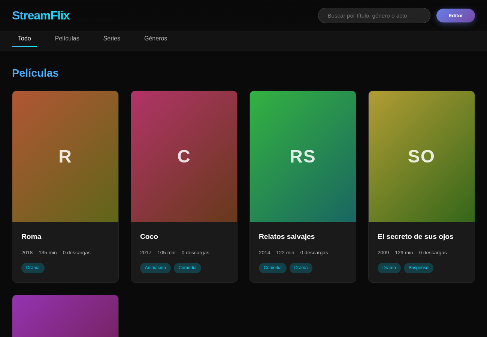

# streamflix-pocketbase

[](https://github.com/Whiteherobot/streamflix-pocketbase/actions/workflows/ci.yml)

Catálogo de películas y series sobre [PocketBase](https://pocketbase.io):
búsqueda por título, género o actor, ficha de cada título con contador de
descargas y un panel para que los editores carguen películas, series,
géneros y actores. Proyecto de febrero de 2026.



## Cómo correrlo

```bash
docker compose up -d --build       # http://localhost:8090
```

El contenedor aplica las migraciones (esquema y catálogo de ejemplo), crea un
superusuario para el panel de PocketBase (`/_/`) y una cuenta de editor:

| Cuenta | Variables | Por defecto |
|---|---|---|
| Superusuario (panel `/_/`) | `ADMIN_EMAIL`, `ADMIN_PASSWORD` | `admin@streamflix.local` / `cambiar-esta-clave` |
| Editor (botón "Editor" de la página) | `EDITOR_EMAIL`, `EDITOR_PASSWORD` | `editor@streamflix.local` / `editor-2026` |

Para algo que no sea una prueba local, definir esas variables antes de
levantarlo. Otras cuentas de editor se crean desde el panel, en la colección
`editores`.

## Cómo está armado

| Carpeta | |
|---|---|
| `pb_migrations/` | Colecciones `peliculas`, `series`, `generos`, `actores` y `editores` (auth), con sus reglas; catálogo de ejemplo. |
| `pb_hooks/descargas.pb.js` | `POST /api/descargas/{peliculas\|series}/{id}`: suma una descarga en una sola sentencia SQL. |
| `pb_public/` | La página (HTML, CSS y JS sin dependencias además del SDK de PocketBase). La sirve el mismo PocketBase. |

Reglas: cualquiera lee; crear, editar y borrar solo lo puede hacer una
sesión de la colección `editores`, y el contador de descargas no lo puede
fijar nadie a mano.

## Pruebas

```bash
docker compose up -d --build --wait
npm test                           # BASE_URL=http://localhost:8090 por defecto
```

Prueban contra el PocketBase real: lectura pública con relaciones, que sin
sesión no se pueda escribir (ni registrarse como editor), alta de un editor
con relaciones, validaciones (títulos, temporadas, géneros repetidos), que el
contador no se pueda fijar a mano y que 25 descargas simultáneas sumen 25.

## De dónde sale

En 2026 se revisó el proyecto (antes `david`). La página apuntaba a un túnel
de ngrok que ya no existe y el repositorio no tenía el esquema de la base, así
que no se podía levantar. Además:

- La "contraseña de administrador" (`admin123`) estaba en el JavaScript del
  navegador y no protegía nada: la escritura dependía de las reglas de la base,
  que tenían que estar abiertas. Ahora la escritura exige una sesión de editor.
- Las descargas se contaban leyendo el valor y escribiendo valor + 1 desde el
  navegador (dos descargas a la vez se pisaban y cualquiera podía editar el
  registro). Ahora las suma el servidor de forma atómica.
- Los títulos y nombres se insertaban con `innerHTML`, así que un título con
  HTML se ejecutaba en la página de todos. Ahora todo se arma con nodos.
- Las series se guardaban en `relase_date` (errata) mientras las películas
  usaban `release_date`; los actores tenían campos con mayúscula; el campo del
  póster se llamaba `video_file`. El esquema nuevo es uno solo y consistente.
- Se quitaron el `pocketbase.exe` de 33 MB y los servidores en PowerShell:
  PocketBase se descarga en la imagen de Docker y sirve la página.

Las imágenes de las tarjetas sin póster son degradados generados con las
iniciales del título. El catálogo de ejemplo usa títulos, fechas y premios
reales, sin pósters.

## Autor

Michael Lata ([@Whiteherobot](https://github.com/Whiteherobot))

Licencia MIT.
